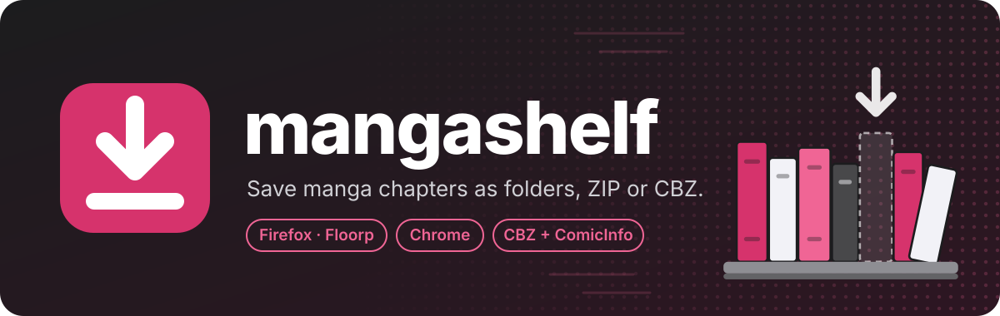

Browser extension that downloads manga chapters and image galleries as a folder of
numbered images, a ZIP, or a CBZ. Best used together with
[YACReader](https://www.yacreader.com) (see [Reading your downloads](#reading-your-downloads)).

## Install

Download the latest version from the
[Releases page](https://github.com/EldinBegano/mangashelf/releases/latest).

**Firefox / Floorp / LibreWolf**
1. Download `mangashelf-<version>-firefox.xpi`.
2. Open `about:addons` → gear icon → **Install Add-on From File…** → pick the file → **Add**.
3. Puzzle-piece menu → gear next to mangashelf → **Pin to Toolbar**.

Updates install automatically. Regular Firefox only installs add-ons signed by Mozilla;
Floorp and LibreWolf don't need that.

**Chrome / Chromium / Brave / Edge**
1. Download `mangashelf-<version>-chrome.zip` and unzip it into a folder you keep.
2. Open `chrome://extensions`, turn on **Developer mode**, click **Load unpacked** and pick that folder.

When a new version is out, the popup says so. Unzip the new version over the same
folder, then click the reload icon on mangashelf in `chrome://extensions`. Your settings stay.

## Use

1. Open a chapter or gallery and click the mangashelf icon.
2. Pick pages (Shift+click selects a range) and choose **Folder**, **ZIP** or **CBZ**.
3. Click **Download**. You can close the popup; the download keeps going.

Files go to `Downloads/mangashelf/<site>/<series>/<chapter>/`.
Settings (⚙ in the popup): save location, default format, parallel downloads, MangaDex quality.

Right-click any image → **Download image with mangashelf**.

**Private windows:** downloads started in a private window show only in private windows,
aren't kept in the browser's download history, and are forgotten when the last private
window closes. The files still save to Downloads. In Firefox/Floorp, allow
**Run in Private Windows** for mangashelf in `about:addons` first.

## Reading your downloads

Save as **CBZ** (in the popup, or as the default in ⚙ settings) and open the files in a comic
reader. Every CBZ includes the series, chapter and right-to-left reading direction, and these
readers pick that up automatically.

| Reader | Runs on | Good for |
|---|---|---|
| [YACReader](https://www.yacreader.com) | Windows, macOS, Linux, iOS | Recommended. Desktop reader with a library and manga mode |
| [Kavita](https://www.kavitareader.com) / [Komga](https://komga.org) | Self-hosted, read in any browser | Phone and PC with synced reading progress |
| [Mihon](https://mihon.app) | Android | Reads CBZ files from your phone's storage ("Local source") |
| [MComix](https://sourceforge.net/projects/mcomix/) | Linux, Windows | Lightweight, right-to-left double pages |

YACReader only opens comic files (CBZ, CBR, PDF), not loose images, so pick **CBZ** rather
than **Folder**. For Kavita and Komga, set the folder template in ⚙ to `{series}/{chapter}`
so each series gets its own folder.

## Supported sites

- **Full support:** MangaDex and the Manganato family (Manganato, Manganami, MangaKakalot, MangaNelo)
- **Tested with the image picker:** Webtoons, Weeb Central, Asura Scans, MangaRead, Imgur
- **Other sites:** shows every image on the page to pick from. If images load as you
  scroll, click **Scroll & rescan**.

Full list and known problems: [SUPPORTED_SITES.md](SUPPORTED_SITES.md).
